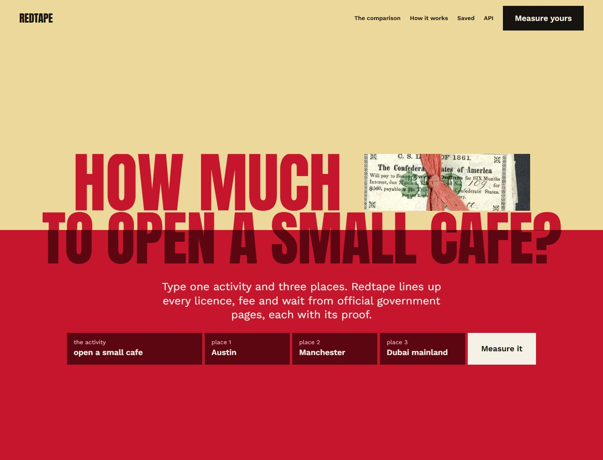

# Redtape



A founder asks: where should I set up? Redtape takes one activity and three places and lines up every licence, permit, registration and filing each place asks for, in the same rows, with the fee, the wait, the renewal and the ongoing filings. Every item carries the official page it came from, the sentence on that page it rests on, and the day Redtape itself read that page again. A fee no official page states is left open, never guessed. It ends with a recommendation, the trade-off for each place, and a sheet of questions to hand to a lawyer. It was built for the TinyFish Compliance Map bounty and runs from one Cloudflare Worker with D1.

## Live

https://redtape.hamdanesmail12-7a9.workers.dev

Five clicks show the whole product:

1. [The home](https://redtape.hamdanesmail12-7a9.workers.dev/): the form, and a real comparison under it.
2. [Opening a small cafe](https://redtape.hamdanesmail12-7a9.workers.dev/comparisons/wm2g9l7x7506) in Austin, Manchester and Dubai mainland: 21 items in 7 rows. Open any cell for its authority, its quoted sentence, its link and its check.
3. [Running a small commercial drone business](https://redtape.hamdanesmail12-7a9.workers.dev/comparisons/hhz1bng4uq43) in the United Kingdom, Singapore and Dubai: 25 items in 8 rows.
4. [The sheet for a lawyer](https://redtape.hamdanesmail12-7a9.workers.dev/comparisons/wm2g9l7x7506/brief): every unclear rule and one question for every gap, made to print.
5. [About](https://redtape.hamdanesmail12-7a9.workers.dev/about): each TinyFish service with its calls and spend, from the ledger.

Each comparison also comes as [JSON](https://redtape.hamdanesmail12-7a9.workers.dev/api/comparisons/wm2g9l7x7506) and as [CSV](https://redtape.hamdanesmail12-7a9.workers.dev/api/comparisons/wm2g9l7x7506.csv), one row per item. Live figures are at [/api/stats](https://redtape.hamdanesmail12-7a9.workers.dev/api/stats).

## What a comparison holds


- **The grid.** The research is held to one fixed layout, so the same categories come back for each place and every item has the same eight fields: required, authority, fee, time, renewal, ongoing filings, official URL, and the sentence quoted from that page.
- **The tape.** Each place has one piece of tape per item: red when its fee is stated and found on the page, pale when stated but not confirmed, open when no official page states it.
- **The figures.** For each place: how many fees are stated of how many, the stated fees added up ("at least GBP 150") when they share a currency, the longest stated wait in the page's own words, and the number of gaps. Currencies are never converted.
- **The verdict.** The research's own recommendation, with one trade-off line for each place, over the figures it stands on. When the place it names has more than half of its fees not stated, the page says so: "Dubai mainland cannot be judged on cost: 7 of 7 fees are not stated on official pages."
- **The sheet for a lawyer.** Every rule the report called unclear, then one question written from each gap, with the link.

## Nothing is taken on trust

A research report can cite a page and still misquote it. So for every item Redtape reads the official page again itself and looks for the quoted sentence: a run of the quote's words, in order, at least 8 words long (or the whole quote when it is shorter) and at least 60% of the quote. When the item states a fee, the amount must be on that page too.

| What the check found | What the item says |
|---|---|
| The sentence, and the fee's amount if one is stated | "Read again on 10 Nov 2026: the sentence is on the page." |
| The sentence, but not the fee | "The sentence is on the page; the fee is not. Confirm the fee." |
| No such sentence | "Not confirmed: the page did not show this sentence when read on 10 Nov 2026." |
| The page could not be read | "The official page could not be read on 10 Nov 2026." |

On the two saved comparisons that is 46 items: 35 proved, 3 with the sentence but not the fee, 6 not confirmed, and 2 whose page (a city council's) could not be read on the day. The 11 that are not proved stay in the grid, marked, count as gaps, and each becomes a question on the lawyer's sheet. None is dropped and none is shown as proved.

A source is labelled, never filtered: "government domain", or "official body's own site, not a government domain" for a regulator such as the UK's aviation authority, whose address ends in `.co.uk`.

## Watching the pages

A saved comparison can be watched. Each official page that carries a proved fee gets a TinyFish Page Monitor that reads it once a day. When a Monitor reports a change, Redtape reads the page again and runs the proof check again for the items that rest on it. A sentence that is still there keeps its result with the new day. A sentence that is gone turns the item into "The official page changed on <date>: check this item again.", which counts as a gap and becomes a question for the lawyer.

## How TinyFish is used

| Service | What it does in Redtape | Where in the code | How to see it working |
|---|---|---|---|
| TinyResearch | Reads each place's official rules in `deep` mode and returns every requirement in the fixed layout, each point cited. | `src/research/question.ts`, `src/research/report.ts`, `src/tinyfish/research.ts` | The grid, the verdict and "unclear" on any comparison |
| Search | Finds each place's official sites before the research so it can be held to them, and looks on an item's own official host for a page that may hold a fee the report could not find. | `src/tinyfish/search.ts`, `src/brief/lead.ts` | "A page on the same site that may hold the fee" on the lawyer's sheet |
| Fetch | Reads every official page again for the proof check, and reads a watched page again when it changes. | `src/tinyfish/fetch.ts`, `src/check/proof.ts` | The check line in any open cell |
| Monitor | Watches the fee pages of saved comparisons, once a day, and calls the Worker's hook after each read. | `src/tinyfish/monitor.ts`, `src/watch/watch.ts` | "Watched" on a saved comparison, and `tinyfish.monitor` in `/api/stats` |

Each does a job nothing else here does. Without TinyResearch there is no comparison. Without Search the research is not held to official sites and a missing fee has no lead. Without Fetch nothing is proved. Without Monitor a saved comparison goes stale without anyone knowing.

Every call is one row in Redtape's own ledger with its price, and the About page adds them up. A research run is booked from what the TinyFish wallet shows was charged, read again ten minutes after the run ends.

## API, briefly

```bash
curl -s -X POST https://redtape.hamdanesmail12-7a9.workers.dev/api/comparisons \
  -H 'content-type: application/json' \
  -d '{"activity":"open a small bookshop","places":["Austin, Texas","Manchester, England","Dubai mainland"]}'
```

The answer is `202 {"id": "...", "state": "queued", "cached": false}`. A comparison moves through `queued`, `finding`, `researching`, `checking` to `ready` (or `failed`, with the reason in plain words) and finishes on its own: a job runs every minute whether or not anyone is watching. `GET /api/comparisons/<id>` returns it:

```json
{ "id": "wm2g9l7x7506", "activity": "open a small cafe", "state": "ready",
  "places": ["Austin, Texas", "Manchester, England", "Dubai mainland"],
  "items": [{ "place": "Manchester, England", "category": "Legal entity registration",
              "name": "Companies House Incorporation (Limited Company)", "authority": "Companies House",
              "fee": "GBP 100 (online/software incorporation); GBP 124 (paper); GBP 156 (same-day)",
              "time": "not stated (same-day option available at higher fee)",
              "url": "https://www.gov.uk/…", "quote": "Incorporation | £100 | £100 | £124",
              "check_kind": "found", "check_result": "Read again on 10 Nov 2026: the sentence is on the page.",
              "checked_at": "2026-11-10T09:38:39.630Z", "source_label": "government domain", "watched": false }],
  "figures": [{ "place": "Manchester, England", "requirements": 7, "feesStated": 4, "feesOf": 7,
                "feesSum": "at least GBP 150", "feesNotStated": 3, "gaps": 6 }],
  "verdict": { "heading": "Shortest tape: Manchester, England", "paragraph": "Manchester is the easiest place to start. …",
               "tradeoffs": [{ "place": "Austin, Texas", "line": "Moderate complexity and moderate cost; …" }] },
  "unclear": ["Austin, Texas – The official Certificate of Occupancy page does not state any specific fee …"],
  "questions": [{ "kind": "time_not_stated", "place": "Austin, Texas", "item": "Texas LLC Certificate of Formation",
                  "text": "How long does Texas LLC Certificate of Formation take in Austin, Texas? …", "url": "https://www.sos.state.tx.us/…" }] }
```

The example is cut short: an item has 19 fields, and this comparison has 21 items and 34 questions.

Other routes: `GET /api/comparisons` (the saved ones), `GET /api/comparisons/<id>.csv`, `GET /api/stats`. The [API page](https://redtape.hamdanesmail12-7a9.workers.dev/api) documents each.

## Run it locally

Needs Node 24 or later.

```bash
npm install
cp .dev.vars.example .dev.vars    # then fill in the three values
npm run migrate:local
npx wrangler d1 execute DB --local --file scripts/seed-local.sql
npx wrangler dev --var SITE_ENABLED:1
```

The seed holds invented comparisons in invented places, so every screen and state can be seen without a TinyFish call.

```bash
npm test          # no network: every TinyFish call is intercepted
npm run check     # typecheck, tests and wrangler deploy --dry-run (what CI runs)
```

To deploy a copy of your own, follow [docs/runbook.md](docs/runbook.md).

## How it was built and verified

**Tested first.** On 9 November 2026 I ran three TinyResearch questions before writing any product code. A loose question gave a good report whose categories drifted between places. The same question with a fixed layout gave 7 categories, the same 7 for each place, and every item with all 8 fields. That layout is the product's question. The design is in [docs/specs/2026-11-09-redtape-design.md](docs/specs/2026-11-09-redtape-design.md), the plan in [docs/plans/](docs/plans/), and what changed while building, and why, in [docs/build-log.md](docs/build-log.md). The look is set in [DESIGN.md](DESIGN.md).

**The two saved comparisons** are those test runs of 9 November, adopted by run id at no cost. Their proof checks ran on the live Worker on 10 November 2026.

**Tests.** 280 tests on 10 November 2026, none of which touches the network. `npm run check` runs in GitHub Actions on every push ([.github/workflows/check.yml](.github/workflows/check.yml)).

**Found on real data, then fixed.** Reading the two real comparisons line by line turned up what no made-up report had. "Form 1023 filing fee: USD 600" must give 600, not 1023. "Flyer ID: free; GVC: not stated" must not give a fee of 1. A fee that says "not stated" halfway through is still a gap. "Manchester is the easiest place" must be matched to the asked place "Manchester, England". Each is in the build log with its test.

**Made to fit the free plan.** The proof check first compared every quote word with every page word, 6 to 15 ms of processor time on a 64,818-character page. It now looks only around the places where the quote's longest middle word appears: about 0.6 ms, the same results on all 46 real pages and on 400 made-up ones.

## Limits and posture

- Redtape reads rules on public official pages. It never checks whether a person or a business holds a licence.
- It is a starting point to confirm with a lawyer, not legal advice, and every page that shows a comparison says so.
- Visitors can start 2 comparisons a day in all, 1 each, and one runs at a time. A new research run is budgeted at $2 and all paid work stops at $8 of total spend. A capped request gets a plain reason. Stored comparisons always open.
- A visitor's comparison is deleted after 7 days. A visitor is known only by a salted hash of their address.
- No number in the grid ever comes from a page that is not the item's own official page. A search lead is worded as a lead.
- Standard reads only. A page that refuses to be read is reported as not read.
- The fixtures and the local seed are invented: invented places, authorities and `.gov.example` pages.

## Licence

MIT. Picture credits are on the [About page](https://redtape.hamdanesmail12-7a9.workers.dev/about) and in `design/credits.json`.
